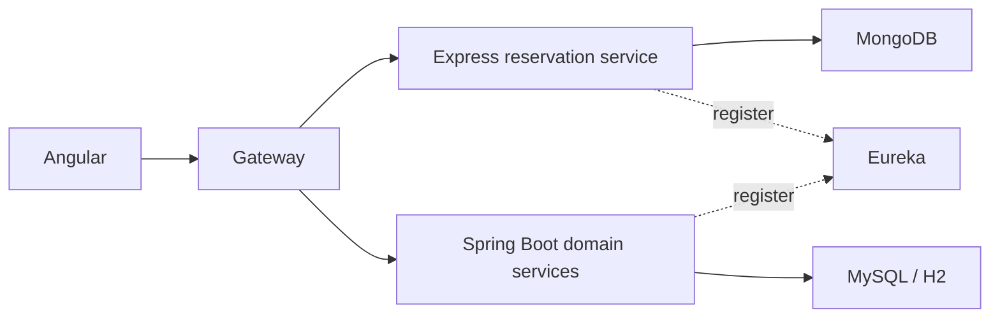

# University housing microservices

An academic team project for university housing: students, residences, rooms, blocks, universities and reservations. The repository combines an Angular interface, Spring Boot services, an Express reservation API, Eureka discovery and a gateway.

**Ameni’s contribution:** the Node.js/Express reservation service, with MongoDB/Mongoose persistence and Eureka registration. The broader platform is team work. [Professional work and contact](https://amenibensaadaportfolio.netlify.app/?utm_source=github&utm_medium=profile&utm_campaign=personal_brand).

## Architecture



| Directory | Responsibility |
| --- | --- |
| `ReservationMS` | Express reservation CRUD, MongoDB, Eureka registration |
| `angular_ms` | Angular 15 interface |
| `API_Gateway_Server` | Routes to domain services |
| `Eureka` | Service discovery |
| `ChambreMS`, `BlocMS`, `FoyerMS`, `UniversiteMS`, `UserMS` | Team-built Spring Boot services |

## Run the reservation API independently

Use Node.js 22+ and a local MongoDB instance. From `ReservationMS`:

```sh
npm ci
cp .env.example .env
npm test
npm start
```

The example disables Eureka for independent local use and connects to `mongodb://127.0.0.1:27017/reservation`. Set `EUREKA_ENABLED=true` and `EUREKA_CLIENT_SERVICEURL_DEFAULTZONE=localhost` to use a registry on port 8761. Despite its historical name, that variable expects the registry hostname, not a complete URL. In Compose, the service sets this hostname to `eureka` and registers itself as `reservation:3000`.

```sh
curl -X POST http://localhost:3000/reservation/reservations \
  -H 'Content-Type: application/json' \
  -d '{"chamberId":12,"etudiantId":[4]}'
curl http://localhost:3000/reservation/reservations
```

Use MongoDB’s returned `_id` for GET, PUT and DELETE at `/reservation/reservations/:id`. Filtering is available at `/reservation/reservations/chamber/:chamberId`. Creation and replacement require a positive integer `chamberId`, a nonempty array of positive student IDs, and optionally a valid `reservationDate`. Unsupported fields are rejected. Invalid IDs return 400; missing records return 404; unexpected storage errors return a generic 500.

## Tests and CI

`npm test` runs HTTP contract tests against isolated test storage: CRUD, filtering, payload validation, missing records, malformed JSON and storage failures. It does not require a database.

For the separate real MongoDB integration test, set `MONGODB_TEST_URL` to an isolated test database and run `npm run test:integration`. GitHub Actions supplies MongoDB 7, runs both suites and builds the reservation container. The small native-fetch Eureka adapter covers registration, heartbeat/re-registration and deregistration, with a local HTTP contract test. It does not implement Eureka discovery or load balancing. The integration test creates and removes its own record; use a disposable database.

## Full platform

`docker compose config --quiet` validates the Compose configuration. The main Compose file records the original academic stack. Build contexts have been normalized for Linux and the university service’s folder case corrected. The legacy Java/database stack still needs environment-specific verification before treating the full platform as a supported one-command deployment.

| Service | Host port |
| --- | --- |
| Angular | 3500 |
| Gateway | 8090 |
| Reservation API | 8080 (container 3000) |
| Eureka | 8761 |
| MongoDB / MySQL | 27017 / 3306 |

## Project status

This is an educational team project, not a hosted production service. The reservation API received a focused validation/test/configuration cleanup in November 2026. No authentication or access-control layer has been added to that service. Other services retain historical dependency versions and local database defaults. The frontend’s generated README is retained in its directory; this root document explains the overall project. No production-readiness or current security-audit claim is made for the complete legacy stack.

Generated Java build outputs, IDE metadata and local `.env` files are excluded from new commits. Professional employer repositories remain private.
